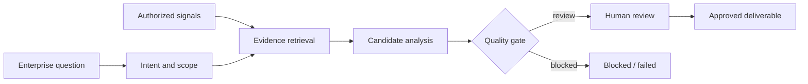
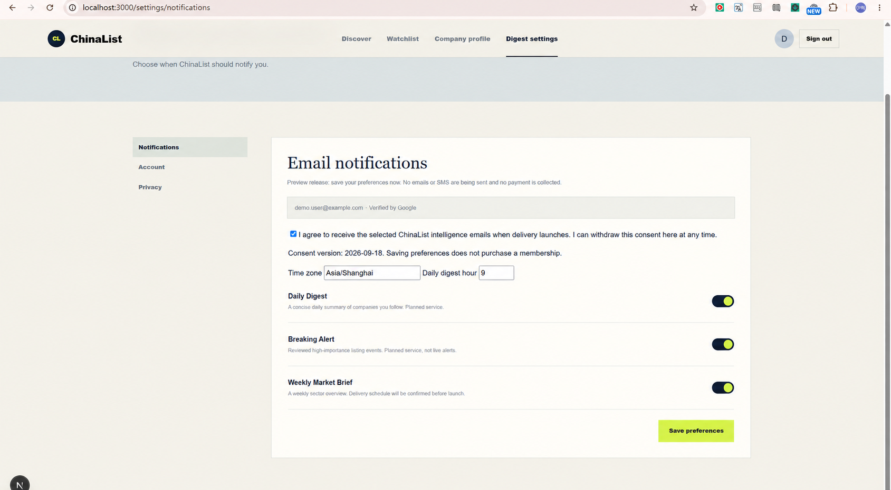
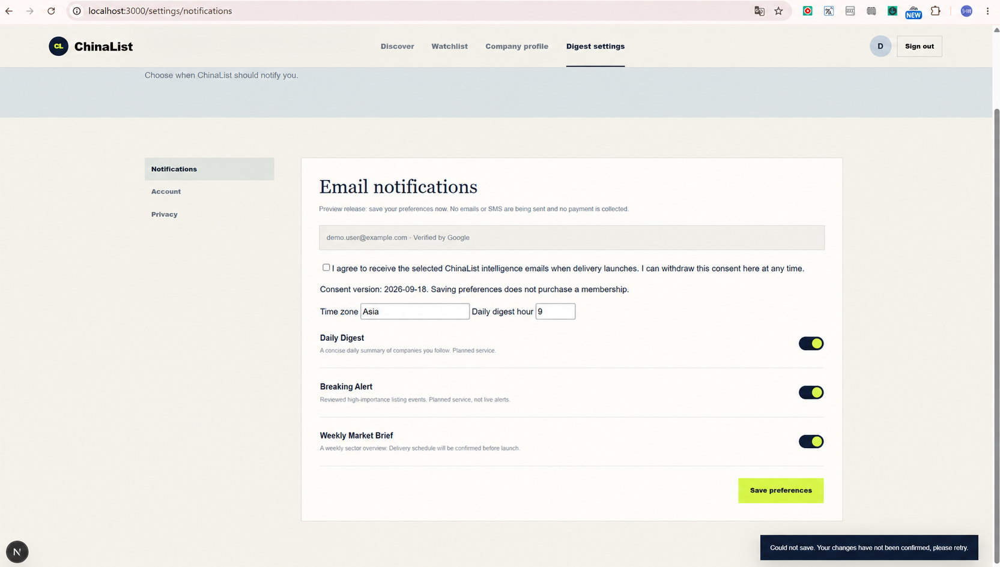

# EqualOcean Internship Portfolio — Sanitized Case Studies

This repository documents three pieces of work from an AI Agent and data-product internship. It is a **sanitized portfolio**, not a copy of the employer's repositories.

No company source code, credentials, internal endpoints, customer records, private prompts, database details or production screenshots are included.

## Featured: Auditable Operations Agent

The central project is a local proof of concept for turning an enterprise question and authorized behavior signals into evidence-linked content, lead and outreach candidates.

- product architecture evolved from an operations hub plus five capability agents into one testable orchestrator for the first POC;
- explicit state machine and failure states;
- evidence retained for important conclusions;
- customer isolation, selective memory and retention controls;
- lead score used for prioritization, never presented as conversion probability;
- no automatic email, publishing or subscription changes;
- current local core POC verified with **62 automated regression tests**.

[Read the sanitized case study](docs/operations-agent.md)

## Other product work

### ChinaList subscription experience

Implemented and validated authenticated account, privacy and subscription flows for an enterprise-intelligence product: database sessions, protected pages/APIs, consent withdrawal, time-zone-aware preferences, personal/team watchlists and digest previews.

- **14 unit tests**, TypeScript check, lint and production build passed in the working branch;
- preview and test-delivery paths only; no claim of production billing or unrestricted sending;
- the screenshots below come from the local development build and have been sanitized to remove personal account information.

The error-state screenshot is retained because failure feedback and consent boundaries were part of the work:

[Read the sanitized case study](docs/chinalist.md)

### AI weekly-report workflow refactor

Converted an already-running linear workflow into a design for scheduled, reviewable and replayable execution. The proposal introduced stable task identity, node-level status, retry policies, input hashes, audit gates and feedback archives while preserving the original core pipeline.

[Read the sanitized case study](docs/ai-weekly-workflow.md)

## Verification boundaries

| Item | Verified | Boundary |
|---|---|---|
| Operations Agent | 62 local core regression tests pass | Local POC; no production deployment claimed |
| ChinaList | 14 unit tests + typecheck + lint + production build | Work completed in internal branches; code is not redistributed |
| Weekly workflow | Architecture and delivery plan reviewed from project material | This repository documents the design; it does not claim the entire production rollout |

## Why this repository contains documentation instead of company code

Portfolio evidence should make work assessable without transferring an employer's intellectual property. These pages therefore focus on the problem, decisions, interfaces, safeguards, verification and honest limits. Screenshots are from a local development environment and use a replacement account identity.

