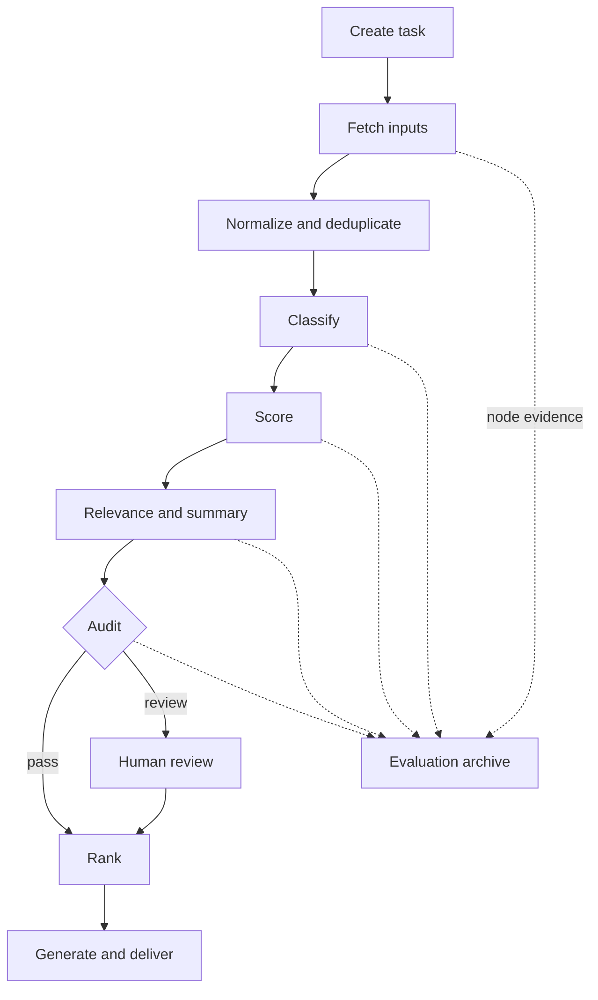

# AI Weekly Report — Workflow Refactor

## Starting point

The existing MVP already performed source filtering, AI classification, value scoring, relevance analysis, report generation and delivery. The refactor focused on operational control around that working core.

## Proposed workflow

## Main design decisions

- one stable task ID across scheduling, execution, audit and archive;
- node-level status and outputs so a failed run can resume;
- input hashes to avoid duplicate work;
- retry policy with bounded backoff;
- separate full, failed-node and conditional reruns;
- configurable automatic checks plus human correction/rejection;
- archive model outputs and feedback for later evaluation;
- prevent duplicate delivery when a task is replayed.

## Product value

This changes the question from “did the model return text?” to:

- which input and model/rule version produced it;
- which node failed and can be rerun;
- whether a person reviewed it;
- whether the same report was already delivered;
- which bad cases should improve the next version.

## Honest scope

The artifact is a refactor proposal and delivery plan built from the project's working MVP. It should be assessed as workflow and product-system design, not as a claim that every proposed module reached production.

